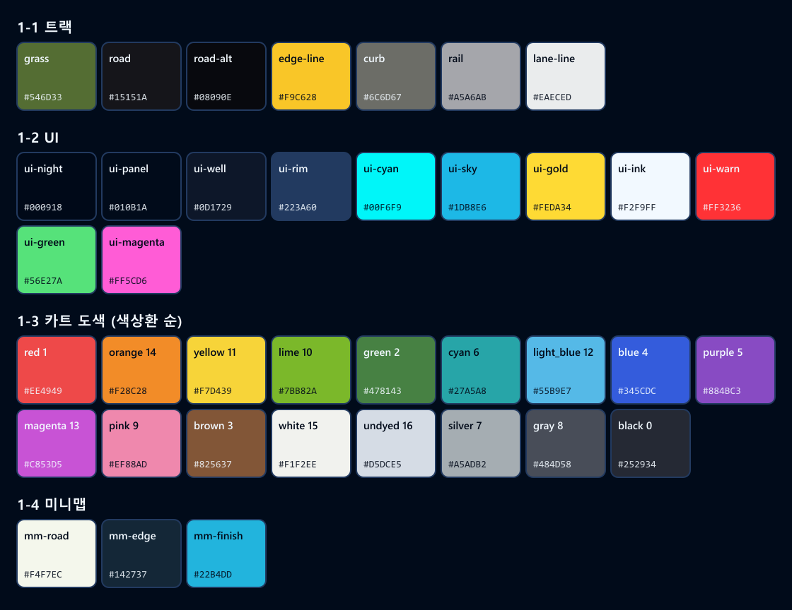

# 핀치 카트 스타일 가이드

디자인 PRD 3장(팔레트·폰트·아이콘)을 작업용으로 옮겼다. **결정 20-11에 따라 팔레트는 PRD의 12색 대신 RetireX Online의 색 체계를 쓴다.** 색을 추가하려면 먼저 이 표와 `Design/tools/palette.mjs`에 넣고, PR 본문에 이유를 쓴다. RetireX 참고 자료(`Design/reference/retirex/`)에서 가져온 원칙에는 출처를 달았다.

## 1. 팔레트 — RetireX 색 체계

색값만 가져왔다. RetireX의 그림 파일은 쓰지 않았고, 마인크래프트 텍스처는 결정 21에 따라 쓰지 않는다. 색값은 다음 두 곳에서 뽑았다. 트랙 색은 RetireX 트랙 재료의 평균색이고, UI 색은 RetireX 메뉴·HUD 이미지의 주된 색이다. 다시 만들려면 `node Design/tools/palette.mjs`를 실행한다.

### 1-1. 트랙(3D 타일)

| 이름 | hex | 쓰는 곳 | RetireX에서 |
| --- | --- | --- | --- |
| `grass` | `#546D33` | 타일 바닥, 트랙 바깥 | 평지 잔디 |
| `road` | `#15151A` | 노면 | 검은 양털 |
| `road-alt` | `#08090E` | 노면 2톤 줄무늬의 어두운 쪽, 출발선 검은 칸 | 검은 콘크리트 |
| `edge-line` | `#F9C628` | 노면 가장자리 선, 가드레일 기둥 | 노란 가장자리 선 |
| `curb` | `#6C6D67` | 연석 | 응회암 연석 |
| `rail` | `#A5A6AB` | 가드레일 판 | 가드레일 화살표판의 금속색 |
| `lane-line` | `#EAECED` | 출발선 흰 칸, 차선(넓은 트랙) | 흰 양털 차선 |

- 노면은 `road`/`road-alt`를 진행 방향으로 8유닛(0.5 m)씩 번갈아 깐다. 넓은 검은 면이 밋밋하면 속도감이 안 난다. RetireX는 이 문제를 검은 재료 2종을 2칸씩 줄무늬로 깔아서 풀었다(`reference/retirex/textures/TEXTURES.md` 2장).
- 바닥과 노면은 어둡고 무채색으로, 선·기둥만 채도를 높게 칠한다. 그래야 카트와 선이 먼저 눈에 들어온다.
- 타일 하나에 색은 7개까지 쓴다(출발 타일이 7개). `tiles.png` 1장에 위 7색이 다 들어 있다.

### 1-2. UI(메뉴·HUD)

| 이름 | hex | 쓰는 곳 |
| --- | --- | --- |
| `ui-night` | `#000918` | 가장 어두운 바탕, 밝은 버튼 위 글자 |
| `ui-panel` | `#010B1A` | 패널·칸 바탕 |
| `ui-well` | `#0D1729` | 움푹한 칸(미니맵 바탕, 썸네일 틀) |
| `ui-rim` | `#223A60` | 패널 테두리 |
| `ui-cyan` | `#00F6F9` | **주 강조**: 선택 테두리, 주 버튼, 체크포인트 통과, 핀치 표시 |
| `ui-sky` | `#1DB8E6` | 게이지·진행 막대, 궤적 선 |
| `ui-gold` | `#FEDA34` | 기록·순위 강조("신기록!", BEST, 난이도 점) |
| `ui-ink` | `#F2F9FF` | 글자(살짝 차가운 흰색) |
| `ui-warn` | `#FF3236` | 경고(손이 안 보임 등) |
| `ui-green` / `ui-magenta` | `#56E27A` / `#FF5CD6` | 보조 버튼 색(RetireX 버튼 5색 중), 1차에는 거의 안 씀 |

- 카드·버튼의 바탕은 당분간 visionOS **글래스 재질**을 쓴다(결정 20-4). RetireX 색은 강조색과 글자에만 입힌다. 목업(`Design/mockups/`)도 그렇게 그렸다.
- 주 버튼은 `ui-cyan` 바탕에 `ui-night` 글자를 쓴다. 보조 버튼은 글래스 바탕에 `ui-ink` 글자를 쓴다.
- 비활성은 `ui-ink`를 40 % 불투명으로 칠한다(새 색이 아님).

### 1-3. 카트 도색 17색

번호는 RetireX의 색 번호다. 미니맵 마커 그림 `marker_N`·`self_N`과 같은 번호를 쓴다(`reference/retirex/minimap/MINIMAP.md`). 이름은 앱의 텍스처 변형 이름이다.

| 순서 | 이름 | 번호 | hex | 순서 | 이름 | 번호 | hex |
| --- | --- | --- | --- | --- | --- | --- | --- |
| 1 | `red` | 1 | `#EE4949` | 10 | `magenta` | 13 | `#C853D5` |
| 2 | `orange` | 14 | `#F28C28` | 11 | `pink` | 9 | `#EF88AD` |
| 3 | `yellow` | 11 | `#F7D439` | 12 | `brown` | 3 | `#825637` |
| 4 | `lime` | 10 | `#7BB82A` | 13 | `white` | 15 | `#F1F2EE` |
| 5 | `green` | 2 | `#478143` | 14 | `undyed` | 16 | `#D5DCE5` |
| 6 | `cyan` | 6 | `#27A5A8` | 15 | `silver` | 7 | `#A5ADB2` |
| 7 | `light_blue` | 12 | `#55B9E7` | 16 | `gray` | 8 | `#484D58` |
| 8 | `blue` | 4 | `#345CDC` | 17 | `black` | 0 | `#252934` |
| 9 | `purple` | 5 | `#884BC3` | | | | |

**색상 스와치(결정 20-2)**

- 순서는 위 표의 "순서" 열이다. 빨강부터 색상환을 한 바퀴 돈 뒤 흰색에서 검정까지 무채색을 놓는다.
- 원 지름은 28 pt, 간격은 10 pt로 한다(1 m 거리 기준, visionOS 최소 눈 대상 크기 맞춤). 한 줄에 9개씩, 두 줄이다.
- 선택한 원에는 2 pt `ui-cyan` 링과 2 pt 틈을 둔다. 그 아래에 색 이름을 작게(13 pt, `ui-ink` 70 %) 보여 준다.
- 무채색 원(`white`, `undyed`, `silver`)에는 1 pt `ui-rim` 테두리를 둔다. 밝은 글래스 위에서도 원이 보이게 하려는 것이다.

### 1-4. 미니맵

| 이름 | hex | 쓰는 곳 |
| --- | --- | --- |
| `mm-road` | `#F4F7EC` | 노면(한 가지 색, 높이 색 없음) |
| `mm-edge` | `#142737` | 노면 테두리 |
| `mm-finish` | `#22B4DD` | 결승선, 출발 점 |

- 바탕은 `ui-panel`을 78 % 불투명으로 깐다. RetireX 미니맵 틀도 알파 78 %다.
- 카트 마커는 그 카트의 도색 색(1-3)으로 칠한다. 자기 카트는 화살표, 다른 카트는 점이다.

## 2. 폰트

| 용도 | 폰트 | 크기(1 m 거리) |
| --- | --- | --- |
| 앱 제목, 카운트다운 숫자 | Galmuri(한글 픽셀 폰트, SIL OFL 1.1, 결정 20-5) — `Design/fonts/` | 제목 48 pt, 카운트다운 120 pt |
| HUD 숫자(랩·타임·속도) | SF Pro Rounded Semibold, 고정폭 숫자(`monospacedDigit`) | 타임 34 pt, 랩 28 pt, 속도 22 pt |
| 라벨·안내·메뉴·버튼 | SF Pro Regular/Medium | 17~20 pt |

- 픽셀 폰트는 제목에만 쓴다(결정 20-3). 본문·숫자·라벨·버튼은 시스템 폰트를 쓴다.
- 목업은 Windows에서 만들어 SF Pro 대신 Segoe UI·맑은 고딕으로 그렸다. 실제 앱에서는 위 표의 폰트를 쓴다.

## 3. 아이콘

| 규칙 | 값 |
| --- | --- |
| 격자 | 24 × 24, 픽셀 정렬 |
| 선 | 2 px, 모서리 직각(`stroke-linecap: square`, `stroke-linejoin: miter`) |
| 색 | SVG 안에서는 `currentColor`. 상태 색은 코드가 입힌다 |
| 상태 색 | 활성 `ui-cyan`, 비활성 `ui-ink` 40 %, 경고 `ui-warn` |
| 파일 | `Design/icons/icon_<이름>.svg` |

세트: `hand_left_pinch`, `hand_left_open`, `hand_right_pinch`, `hand_right_open`, `arrow_forward`, `arrow_forward_full`, `arrow_left`, `arrow_right`, `spread`, `stop`, `flag_checkpoint`, `flag_finish`, `play`, `pause`, `restart`, `hand_missing`, 그리고 미니맵용 `minimap_start_flag`, `minimap_checkpoint_1~3`. 한 장 미리보기는 `Design/icons/_sheet.png`다.

**카트 그림(결정 20-1)**

| 쓰는 곳 | 파일 | 규격 |
| --- | --- | --- |
| 메뉴 카트 카드 | `Design/karts/kart_<id>_thumb.png` | 3D 렌더(RetireX 차고 그림), 512 × 384 투명 바탕, 정수배 확대 |
| HUD·미니맵·목록 같은 작은 표시 | `Design/karts/kart_<id>_silhouette.svg` | 24 × 24 픽셀 옆모습, 앞이 오른쪽, `currentColor` = 그 카트의 도색 색 |

5종(`arcrix`, `bogubkart`, `gospel`, `razr`, `sirius`)의 미리보기는 `Design/karts/_sheet.png`다. 실루엣은 카트 모델 형상에서 자동으로 뽑은 초안이다. 24 px라 차종 구분이 약하니, 필요하면 픽셀 편집기에서 손으로 다듬는다.

## 4. 3D 에셋 공통

| 항목 | 값 |
| --- | --- |
| 단위 | 16 유닛 = 1 m, 내보낼 때 1/16 |
| 타일 | 64 × 64 유닛(4 m), 원점 = 바닥 중앙, 노면 중심은 항상 변의 가운데(32) |
| 텍스처 | 128 × 128 PNG, 알파 없음, 타일 4종이 `tiles.png` 1장을 같이 씀 |
| 정면 | 북쪽(-Z) |

## 5. 하지 말 것

- 1픽셀 디테일, 가는 선. 6 cm 카트·16 cm 타일에서는 읽히지 않는다.
- 색만으로 상태를 구분하는 것. 색과 모양을 함께 쓴다.
- 0.2초보다 빠른 점멸.
- 마인크래프트(Mojang) 텍스처·소리를 앱에 넣는 것. 임시로도 넣지 않는다(결정 21). 대체 텍스처는 `Design/textures/`에서 직접 그린다.
