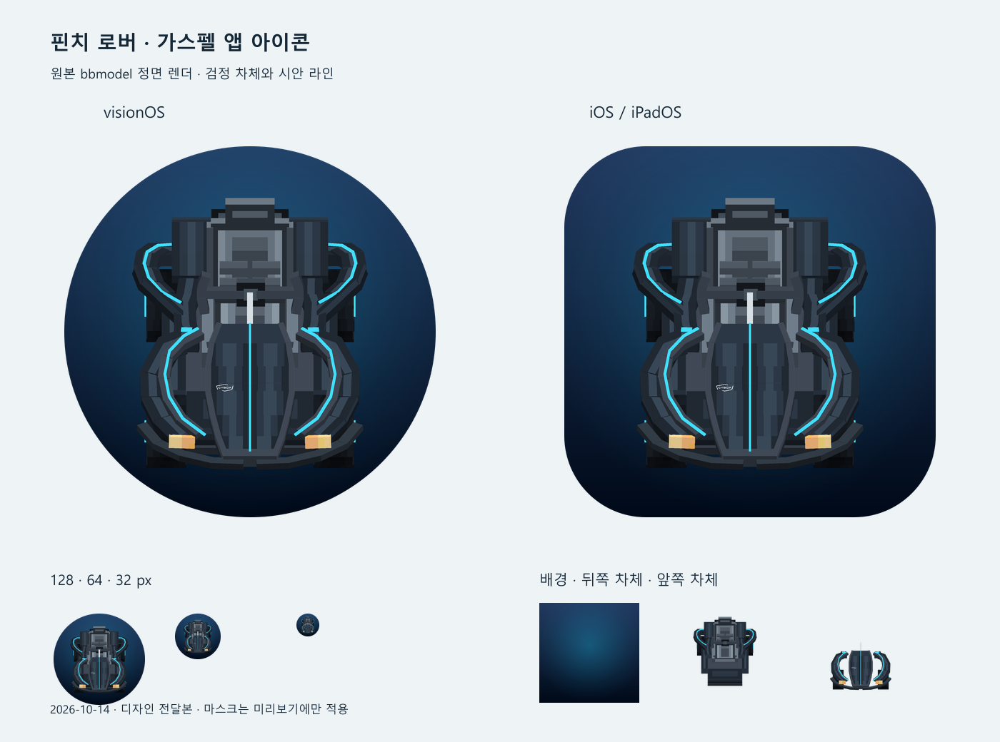

# 스토어 자산 초안 (M6 — Issue #46, 결정 61)

디자인이 정식 스크린샷·아이콘을 내기 전까지 쓰는 테크 초안. 앱 이름은 결정 53의 **핀치 로버 / Pinch Rover**.

## 앱 아이콘

디자인 정식 아이콘(결정 62·65): 대표 카트 가스펠 정면 렌더, visionOS 3층(`AppIcon.solidimagestack`: 배경·뒤 차체·앞 차체)과 iOS 1024(`AppIcon.appiconset`). 원본과 재생성 도구는 `Design/app-icon/`. 미리보기: `Design/app-icon/preview.png`.

## 부제 / 설명 (한국어)

**부제**: 양손 핀치로 달리는 책상 위 복셀 카트

**설명**
핀치 로버는 컨트롤러 없이 손가락 핀치만으로 조종하는 1인용 타임어택 카트 게임입니다. 눈앞 책상 위에 작은 박스 디오라마가 열리고, 그 안의 복셀 트랙을 양손 핀치로 달립니다. 3인칭으로 바꾸면 트랙이 실제 크기로 주변에 깔립니다.

- 트랙 4종: 격자 타일 트랙 1종 + 360° 루프·헬릭스·뱅크 커브가 있는 서킷 3종(공원·네온 나이트·사막 협곡)
- 카트 5종 × 도색 17색
- 3·2·1·GO 카운트다운, 랩·베스트 랩, 신기록, 일시정지, 다시 하기
- 효과음·엔진음·배경음 3곡
- iPhone·iPad에서는 화면 양쪽 엄지로 같은 조작

**키워드**: 카트, 레이싱, 핀치, 손 추적, 복셀, 디오라마, 타임어택, visionOS

## Subtitle / Description (English)

**Subtitle**: Desktop voxel karting you drive with two pinches

**Description**
Pinch Rover is a one-player time-attack kart game driven entirely by hand-tracked pinches — no controller. A small wireframe diorama opens on your desk with a voxel track inside; pinch with both hands to go, release one hand to turn, spread your hands to reverse. Switch to third person and the track surrounds you at real size.

- 4 tracks: a tile track plus 3 circuits with a 360° loop, a helix and banked sweepers (park, neon night, desert canyon)
- 5 karts × 17 paint colors
- 3-2-1-GO, lap and best-lap timing, new-record badges, pause and retry
- Sound effects, engine audio and 3 original music tracks
- On iPhone and iPad, the same controls with two thumbs

## 스크린샷 후보

| 플랫폼 | 파일 | 장면 |
| --- | --- | --- |
| visionOS | `Docs/review/pr14-device-screenshots/01-box-overview-wide.png` | 박스 디오라마 전경 |
| visionOS | `Docs/review/pr14-device-screenshots/06-driving-close.png` | 주행 근접 |
| visionOS | `Docs/review/pr14-device-screenshots/03-kart-select-menu.png` | 카트 선택 메뉴 |
| 서킷 렌더 | `Docs/review/circuits/circuit_02_persp.png` | 리본 루프(네온) |
| visionOS 시뮬레이터 | `Docs/review/vision-sim/loop-inside.jpg` | 리본 루프 360° 루프 안쪽(3인칭, 결정 66) |
| visionOS 시뮬레이터 | `Docs/review/vision-sim/helix-overview.jpg` | 스카이 스파이럴 헬릭스 전경 |
| iOS | `Docs/review/ios/iphone-loop-climb.jpg` | iPhone 추적 시점, 리본 루프 오르기(결정 66) |
| iOS | `Docs/review/ios/iphone-topview-lap2.jpg` | iPhone 탑뷰, 루키 오벌·풍차 |

실기기 스크린샷(visionOS 최신 빌드, iPad)은 출시 전 디자인과 함께 다시 찍는다. 스토어 규격: visionOS 3840×2160, iPhone 6.9" 1320×2868, iPad 13" 2064×2752.

## 개인정보

- 수집 데이터 없음. 최고 기록은 기기 안 `UserDefaults`에만 저장.
- 카메라(iOS AR 시점)·월드 센싱(visionOS 머리 위치)은 기기 안에서만 쓰고 전송하지 않는다.
