# 핀치 로버 (KartSimulator)

> 앱 이름은 **핀치 로버 (Pinch Rover)**로 확정했습니다(결정 53, Issue #30). 문서·코드의 옛 가칭 "핀치 카트"는 같은 앱을 가리킵니다.

**Apple Vision Pro에서 양손 핀치만으로 조종하는 책상 위 복셀 카트 레이싱.**
컨트롤러 없이, 눈앞에 열린 작은 박스 안의 트랙(또는 실제 크기 트랙)을 손가락 핀치로 달립니다.

### 앱 소개 영상 (30초)

<!-- 인라인 플레이어: GitHub 웹 편집기로 30초 원본(PinchRover_Opening_README_720p.mp4, 8.8 MB)을 업로드한 뒤 아래 줄의 주소를 바꾸고 GIF 줄을 지운다.
     2026-10-12 업로드본(…/91630e82-…)은 1.14초·470 KB짜리 다른 클립이라 임시로 뺐다.
https://github.com/user-attachments/assets/91630e82-7d38-4b69-9e3f-95c23f66d8a4
-->

https://github.com/user-attachments/assets/47b5f397-4794-46e4-a431-0a9ec2f93311


[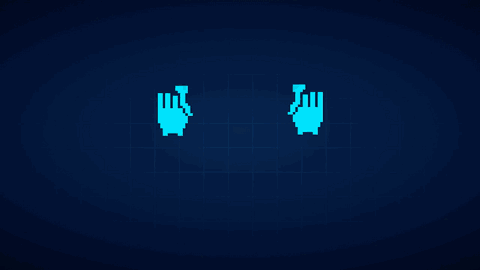](https://github.com/kimminung/KartSimulator/releases/download/v0.3.0/PinchRover_Opening_README_720p.mp4)

▶ 원본(1280×720, H.264, 8.8 MB): https://github.com/kimminung/KartSimulator/releases/download/v0.3.0/PinchRover_Opening_README_720p.mp4 — 릴리스 [v0.3.0](https://github.com/kimminung/KartSimulator/releases/tag/v0.3.0) 첨부 자산. 위 미리보기는 소리 없는 480 px 애니메이션입니다.

| | | |
| --- | --- | --- |
| 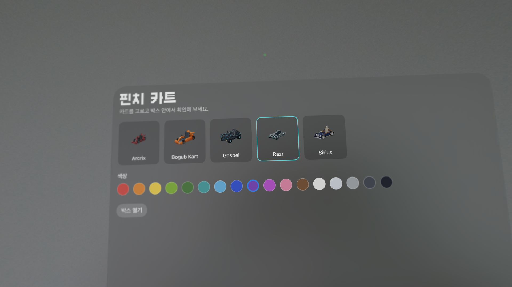 | 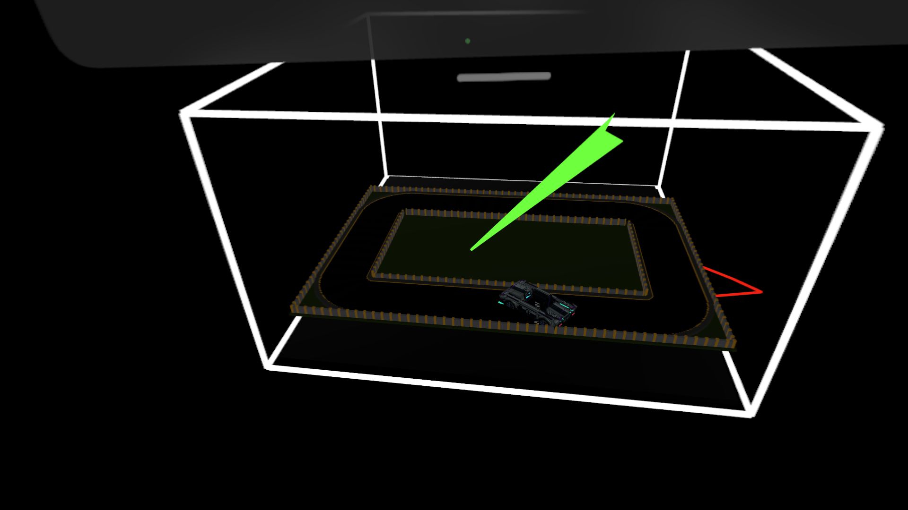 | 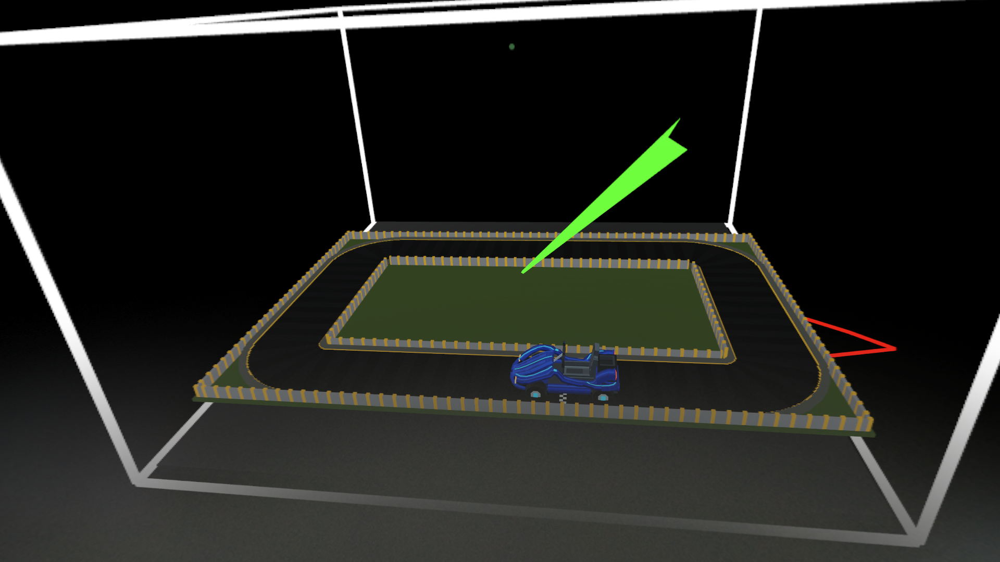 |
| 카트 5종 × 도색 17색을 고르는 메뉴 | 눈앞에 열리는 0.7 × 0.4 × 0.7 m 박스 디오라마 | 타일 트랙 위를 달리는 카트 (실기기 캡처) |

### 실기기 시연 영상

Apple Vision Pro 실기기에서 플레이한 영상입니다. 썸네일을 누르면 YouTube로 이동합니다.

| Phase 2 — 1인칭·3인칭 콕핏 + 디오라마 | Phase 1 — 디오라마 |
| --- | --- |
| [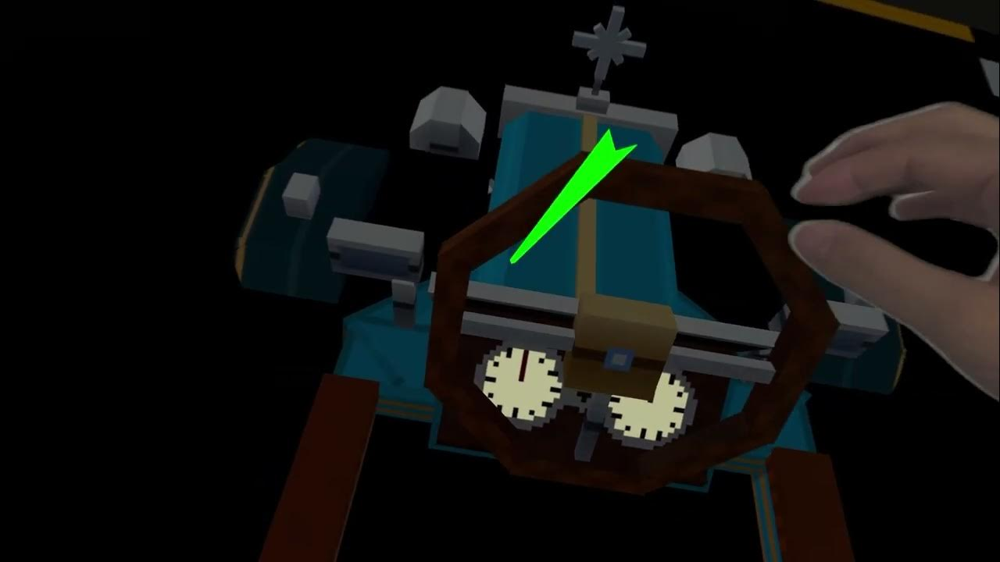](https://youtu.be/PIXJQDFln3s) | [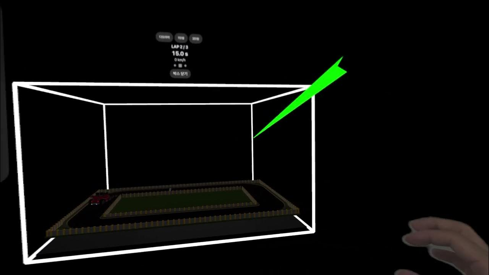](https://youtu.be/Xv__kSJXJ0I) |
| ▶ https://youtu.be/PIXJQDFln3s | ▶ https://youtu.be/Xv__kSJXJ0I |

> **현재 단계: M5 완료 + 서킷 3종(결정 58)** — 운전 모드는 디오라마와 3인칭(실제 크기 트랙, 카트 뒤 추적 카메라) 2종이고(1인칭은 멀미로 폐기, 결정 47·49), 맵은 격자 타일 트랙 1종 + 3D 서킷 3종(360° 루프·헬릭스·뱅크·언덕)입니다. 카운트다운·일시정지·결과·배경음·미니맵까지 들어갔고, 남은 것은 속도계 리소스(#28)와 M6 출시 준비입니다. 위 영상·스크린샷은 Phase 1~2 시점입니다.

| 플랫폼 | 언어·프레임워크 | 테스트 | 상태 |
| --- | --- | --- | --- |
| visionOS 27 (Apple Vision Pro) | Swift · SwiftUI · RealityKit · ARKit 손·머리 추적 · Blender(노면 메시) | Swift Testing (`KartCoreTests` 87개) | M0~M5 완료(속도계 리소스만 대기), 서킷 3종 실기기 확인 중, M6 출시 준비·iOS 버전 남음 |

---

## 목차

1. [소개](#소개)
2. [지금 할 수 있는 것](#지금-할-수-있는-것)
3. [서킷 3종](#서킷-3종)
4. [시작하기](#시작하기)
5. [사용법](#사용법)
6. [앱 구조 (테크)](#앱-구조-테크)
7. [디자인 산출물 (디자인)](#디자인-산출물-디자인)
8. [테크 × 디자인 협업 흐름](#테크--디자인-협업-흐름)
9. [마일스톤](#마일스톤)
10. [저장소 구조](#저장소-구조)
11. [팀](#팀)
12. [라이선스](#라이선스)

---

## 소개

핀치 로버는 visionOS의 **손 추적 핀치 제스처**를 운전 입력으로 쓰는 1인용 3랩 타임어택 카트 게임입니다. 메뉴 창에서 트랙(4종)과 카트·색을 고른 뒤 "박스 열기"를 누르면 눈앞 책상 위에 와이어프레임 박스 디오라마가 열리고, 그 안에 트랙과 카트가 놓입니다. 3·2·1·GO 카운트다운 뒤 배경음과 함께 달리고, 완주하면 랩별 기록과 신기록 배지가 뜹니다. 3인칭으로 바꾸면 트랙이 실제 크기로 주변에 깔립니다.

설계 원칙 세 가지가 프로젝트 전체를 관통합니다.

- **글 없이 아는 조작**: 조작법은 손 그림만으로 이해되게 그렸고(디자인 PRD 9장), HUD는 손 모양·화살표·색으로 지금 입력이 어떻게 읽히는지 바로 보여 줍니다.
- **멀미 배려**: 1인칭 시뮬레이션은 어지러워 폐기했고, 몰입도가 다른 운전 모드 2종(디오라마·3인칭)을 두되 기본은 박스를 밖에서 보는 디오라마입니다(결정 39·47·49).
- **큰 면, 적은 색**: 6 cm 카트와 1 m 거리의 HUD가 한눈에 읽히도록 RetireX 색 체계 기반 팔레트와 픽셀 룩(Galmuri 제목 폰트, 24 px 아이콘)을 씁니다.

## 지금 할 수 있는 것

| 영역 | 내용 |
| --- | --- |
| 카트 | USDZ 카트 5종(`arcrix`, `bogubkart`, `gospel`, `razr`, `sirius`) × 도색 17색. 메뉴 카드에 시선을 두면 1.4배로 커지며 라이브 3D로 바뀌고 드래그로 360° 회전 |
| 공간 | `ImmersiveSpace`(progressive) 안의 박스 프레임 디오라마. Digital Crown으로 몰입도 조절 |
| 트랙 | **4종** — 격자 타일 트랙 '첫 바퀴' + **서킷 3종**(루키 오벌·리본 루프·스카이 스파이럴 — 아래 [서킷 3종](#서킷-3종) 참고)을 시작 화면 카드(경로 썸네일·난이도·특징 태그·최고 기록)에서 선택. 3D 스플라인 중심선 위 **레일 주행**(코너 드리프트·안쪽 라인·중력·벽 미끄러짐), 노면은 Blender가 구운 USDZ. 격자 타일 4종(`straight`/`curve`/`start`/`grass`) 트랙도 계속 읽을 수 있음 |
| 입력 | 양손 핀치 유지=전진, 핀치한 채 벌리면 후진, 한손만 핀치=반대쪽 회전. 디오라마·3인칭 두 모드가 같은 조작(결정 49). HUD 버튼으로 즉시 전환 |
| HUD | 랩·타임·속도 패널, 양손 핀치 상태 + 세로 페달 게이지, 모드 전환 버튼, 카운트다운 3·2·1·GO, 일시정지(재개 카운트다운·다시 시작), 완주 결과(총 시간·랩별·신기록·다시 하기·트랙 선택) (RealityView attachment) |
| 소리 | 효과음 7종(자체 합성) + 엔진음 5종(시동·가속·루프·감속·공회전) 상태 기계 + 배경음 3곡(iMasterProX 작곡, GO 페이드 인 → 완주 페이드 아웃, 머리 고정 재생) |
| 온보딩 | 첫 실행 시 조작법 시트. 두 모드가 같은 손 그림 5장을 쓴다 |
| 미니맵 | Diorama 테이블 위에 트랙 JSON에서 만든 노면·궤적·출발 깃발·체크포인트 라벨·카트 마커·랩 텍스트. 맵 테마 색, 고가 구간(다리·루프) 강조 띠, 구간 라벨(루프·헬릭스·시케인…). 디오라마는 박스 모서리, 3인칭은 HUD 오른쪽 아래에서 머리를 따라옴 |
| 카트 리그 | 핸들 82° 핀치 연동, 코너 바깥 차체 기울기·가감속 피치 (바퀴 굴림은 재내보내기 대기) |

## 서킷 3종

기존 격자 타일 트랙 '첫 바퀴'에 더해, 컨셉이 다른 서킷 세 개를 테크가 직접 만들었습니다(결정 58). 맵은 총 4개입니다. 트랙은 구간 목록(직선·뱅크 커브·언덕·360° 루프·헬릭스)으로 3D 중심선을 생성하고(`Tracks/tools/gen_circuit.py`), 헤드리스 Blender가 노면 메시를 USDZ로 굽습니다(`Tools/build_circuit.py`). 아래 그림은 같은 스크립트가 찍은 확인 렌더입니다.

| | 루키 오벌 (easy) | 리본 루프 (normal) | 스카이 스파이럴 (hard) |
| --- | --- | --- | --- |
| 컨셉 | 낮의 잔디 공원 | 밤의 네온 서킷 | 사막 협곡 |
| 길이 | 129 m | 167 m | 219 m |
| 구간 | 36 m 직선 · 12° 뱅크 커브 · 언덕 | **360° 수직 루프** · 시케인 · 헤어핀 | 오르막 · 브리지 · **360° 헬릭스**(다리 아래로) · 더블 시케인 · 15° 뱅크 스위퍼 |
| 스킬 | 레이싱 라인, 스로틀 유지 | 풀 스로틀로 루프 진입(안에서 핸들 금지), 리듬 조향, 브레이킹 | 오르막 스로틀, 나선 라인, 연속 코너 |
| 위에서 | 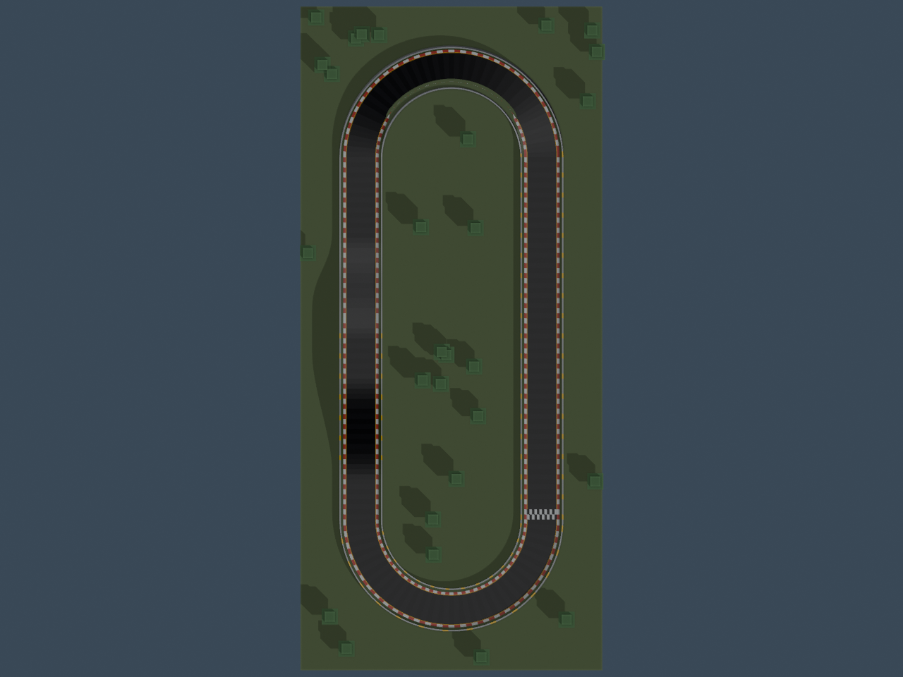 | 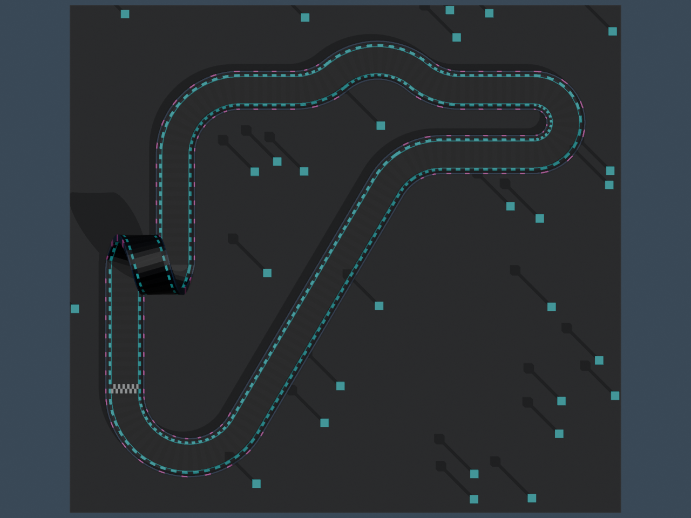 | 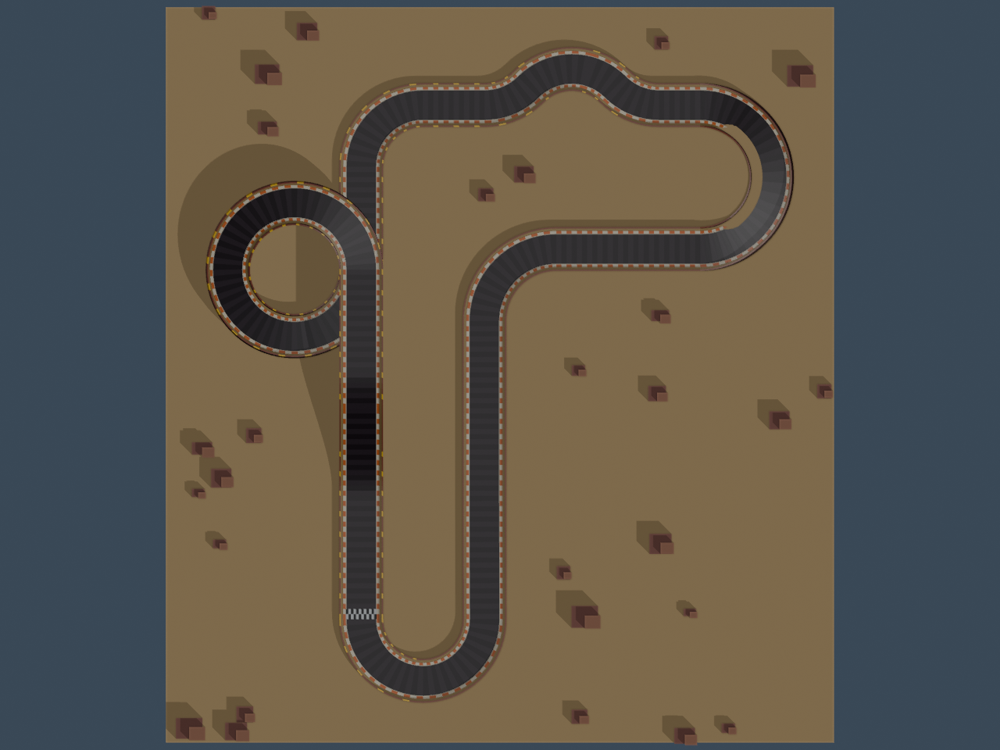 |
| 입체 | 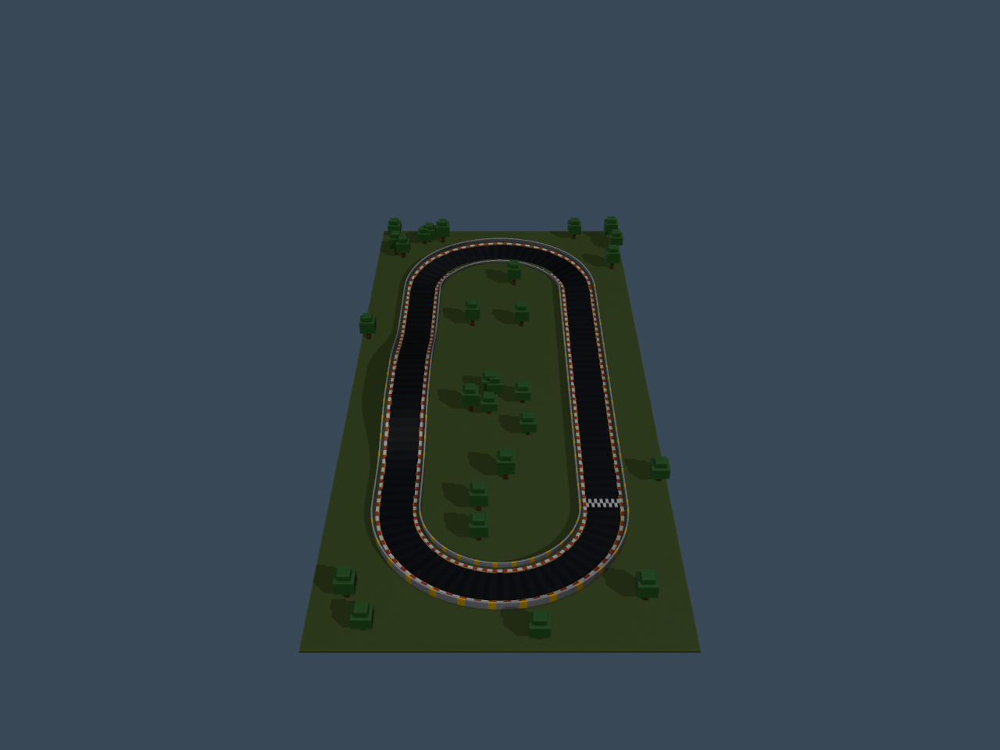 | 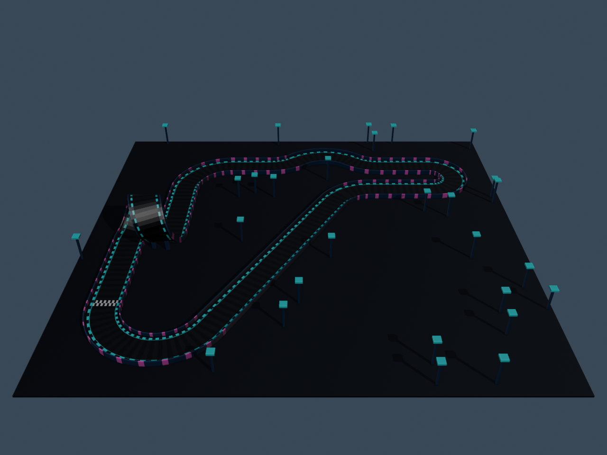 | 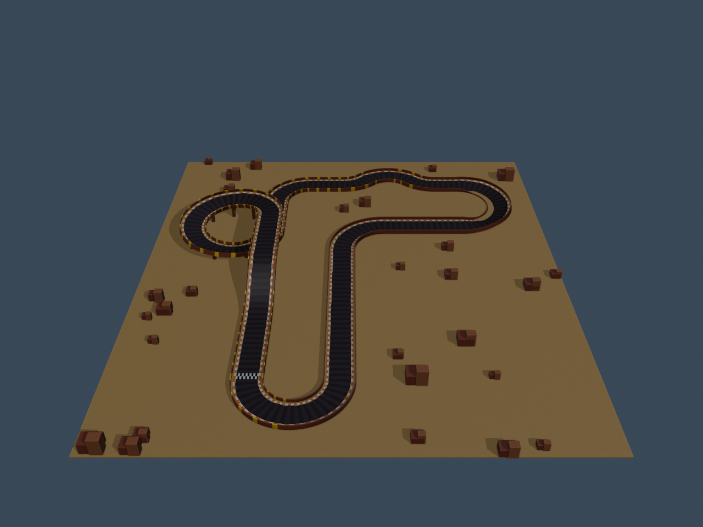 |

**레일 주행**: 카트는 중심선 위를 호 길이·가로 오프셋·상대 yaw로 달립니다. 코너에서 핸들을 안 꺾으면 바깥 벽으로 밀려나고, 안쪽 라인은 실제로 빠르며, 루프·오르막에서는 중력이 작용해 스로틀을 놓거나 한 손 회전만 하면 미끄러져 내려옵니다. 3인칭에서는 세계가 평행이동과 yaw만 하므로 루프를 도는 동안에도 시야가 뒤집히지 않습니다(카트가 오르면 세계가 내려갑니다).

### 서킷 주행 요령

- **루프(리본 루프)**: 직선에서 양손 핀치를 유지한 채 풀 스로틀로 들어가고, 안에서는 핸들(한 손 핀치)을 잡지 마세요. 한 손 핀치는 가속이 없어 중력에 밀려 되돌아 내려옵니다. 내려오면 다시 직선에서 가속해 재도전하면 됩니다.
- **오르막·브리지(스카이 스파이럴)**: 오르막에서는 속도가 줄어드니 스로틀을 끝까지 유지하고, 헬릭스에서는 안쪽 라인을 타면 한 바퀴가 짧아집니다.
- **뱅크 커브(루키 오벌·스파이럴 스위퍼)**: 노면이 안쪽으로 기울어 카트도 함께 기웁니다. 코너 진입 전에 바깥쪽에 붙었다가 안쪽으로 파고드는 라인이 빠릅니다.
- **벽**: 처음 부딪히면 속도가 절반으로 줄고, 붙은 채로 밀면 계속 느려집니다. 벽에서 떨어지려면 반대쪽으로 한 손 핀치를 잠깐 잡으세요.
- **미니맵**: 다리·루프처럼 떠 있는 구간은 강조색 띠로, 루프·헬릭스·시케인 같은 구간은 라벨로 표시됩니다. 맵마다 미니맵 색이 다릅니다.

**검증**: 저장소의 서킷 JSON을 그대로 읽어 단순 자동 조향으로 한 바퀴 도는 통합 테스트가 있습니다(루키 오벌 33 s · 리본 루프 43 s · 스카이 스파이럴 56 s, 벽 충돌 0). 노면 USDZ는 Reality Composer Pro나 Blender 재가져오기로 검수합니다.

## 시작하기

1. 저장소를 클론합니다.
2. `KartSimulator.xcodeproj`를 Xcode(visionOS 27 SDK)에서 엽니다.
3. 실행 대상으로 **Apple Vision Pro 시뮬레이터** 또는 실기기를 고르고 빌드·실행합니다. 손 추적과 Digital Crown은 실기기에서만 온전히 동작합니다.
4. 단위 테스트는 `KartCoreTests` 타깃(Swift Testing)으로 돌립니다. 전부 통과해야 정상입니다(결정 49에서 엔진음 테스트 5개의 오래된 실패를 고쳤습니다).

## 사용법

1. 메뉴 창에서 **트랙**(첫 바퀴·루키 오벌·리본 루프·스카이 스파이럴 — 카드에 경로 썸네일·난이도 점·특징 태그·내 최고 기록)과 **카트·색상**을 고른 뒤 **박스 열기** 버튼을 누르면 눈앞에 트랙 박스가 열립니다. 앉아서 플레이하면 편합니다. 박스가 열린 채로 다른 트랙 카드를 고르면 그 자리에서 트랙이 바뀝니다.
2. 첫 실행 때는 조작법 화면이 자동으로 뜹니다. 위쪽 "디오라마 / 3인칭" 탭으로 모드별 설명을 볼 수 있고(손 조작은 같습니다), 나중에는 메뉴 창의 **조작법** 버튼으로 다시 열 수 있습니다. 이 탭은 설명만 바꿔 보여 줄 뿐, 실제 운전 모드는 바꾸지 않습니다.
3. 박스가 열리면 HUD에 **3·2·1·GO** 카운트다운이 뜹니다. 그동안은 핀치해도 출발하지 않고, GO와 함께 배경음이 들어오며 랩 타이머가 흐릅니다. 박스 위에 떠 있는 HUD 패널에서 운전 모드를 고르고 주행합니다. HUD의 양손 점(핀치 중이면 청록색)·화살표·페달 게이지로 손 입력이 어떻게 인식되는지 볼 수 있습니다.
4. 주행 중 HUD의 **일시정지**를 누르면 카트와 타이머가 그 자리에 멈추고 배경음이 작아집니다. **재개**는 다시 3·2·1·GO를 탄 뒤 이어서 달리고, **다시 시작**은 출발선으로 돌아갑니다.
5. 3랩을 완주하면 카트가 서서히 서고 결과 패널에 총 시간·랩별 시간·베스트 랩이 뜹니다. 트랙·카트별 최고 기록을 기기에 저장해 두고, 깨면 **신기록!** 배지를 보여 줍니다. **다시 하기**로 같은 트랙을 다시 달리거나 **트랙 선택**으로 메뉴 창의 카드로 돌아갑니다. 레이스마다 배경음 3곡이 순서대로 바뀝니다.
6. 주행을 마치면 HUD(또는 메뉴 창)의 **박스 닫기** 버튼으로 닫습니다. 3인칭에서 HUD 버튼이 안 눌리면 차를 세우고 양손을 뗀 채 4초 기다리세요. 메뉴 창이 정면에 다시 뜹니다. 디지털 크라운을 길게 누르면 언제든 홈으로 나갈 수 있습니다.

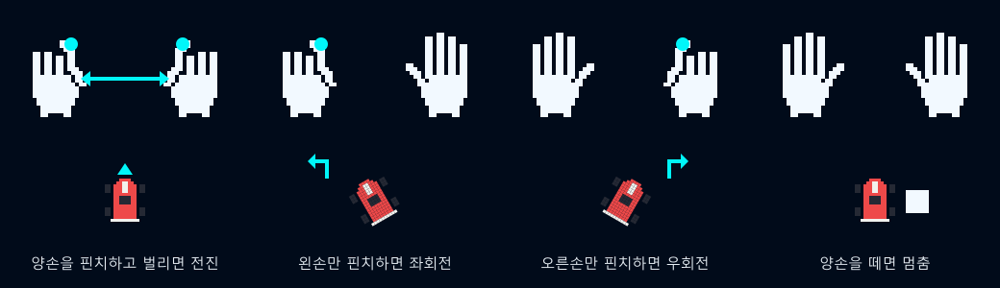

### 운전 모드 2종

1인칭 주행은 어지러움을 일으켜 폐기했고(결정 47·49), 몰입도가 다른 두 모드를 둡니다. **손 조작은 두 모드가 완전히 같습니다.**

| | 디오라마 (기본) | 3인칭 |
| --- | --- | --- |
| **시점** | 박스를 밖에서 내려다봄 | 실제 크기 트랙, 카트 2.5 m 뒤·1.8 m 위에서 카트가 가는 쪽을 보는 추적 시점 |
| **조향** | 한 손만 핀치 → 좌/우회전 | 같음 |
| **전진** | 양손 핀치 유지 | 같음 |
| **후진** | 핀치한 채로 양손 벌리기 | 같음 |
| **고개** | 자유 | ±45° 자유롭게 둘러봄. 60° 넘게 2초 이상 돌려 앉으면 기준 방향이 천천히 따라옴 |

두 모드 모두 양손을 다 떼면 서서히 멈춥니다.

> **3인칭 카메라(결정 47·49)**: 기준 방향은 모드에 들어온 순간 바라보던 쪽으로 고정됩니다. 카트는 그 방향 2.5 m 앞에 있고, 세계는 카트가 가는 쪽이 정면이 되도록 천천히(2.5/s) 돕니다. 고개를 돌려도 카트와 세계는 따라오지 않아 양옆을 볼 수 있습니다. 멀미가 느껴지면 디오라마로 돌아오면 됩니다.

### 모드 전환

HUD 패널 맨 위의 **디오라마 / 3인칭** 버튼 중 원하는 버튼을 **바라보면서 핀치**하면 바로 바뀝니다. 지금 모드는 색이 채워진 버튼으로 표시됩니다.

- **"아이트래킹"은 정확히는 시선+핀치 버튼 선택입니다.** visionOS는 서드파티 앱에 실제 눈동자 방향을 주지 않기 때문에, 다른 visionOS 버튼을 누를 때와 같은 시스템 표준 방식(바라보고 → 핀치)으로 고릅니다.
- 버튼을 보면서 핀치하면 모드 전환, 박스(또는 트랙)를 보면서 핀치하면 운전 입력으로 들어갑니다.
- 박스를 새로 열면 항상 디오라마 모드로 시작합니다.

### 디오라마 모드 (기본)

박스를 밖에서 보면서 카트를 직접 조종합니다.

| 동작 | 조작 |
| --- | --- |
| 전진 | 양손을 핀치한 채로 있으면 전진 (최고 속도까지 가속) |
| 후진 | 핀치한 채로 양손을 벌리면 후진, 더 벌릴수록 빨라짐 (최고 속도는 전진의 절반) |
| 좌회전 | 오른손을 떼면(왼손만 핀치) 좌회전 |
| 우회전 | 왼손을 떼면(오른손만 핀치) 우회전 |
| 정지 | 양손을 떼면 서서히 멈춤 |

- **기준점은 핀치를 시작한 순간의 손 간격입니다(절대 거리 아님).** 손을 가깝게 모으고 시작하든 넓게 벌리고 시작하든 그 자리에서 바로 전진하고, 거기서 더 좁혀도 계속 전진합니다. 기준보다 4 cm 넘게 벌리면 후진이 시작되고, 거기서 25 cm를 더 벌리면 최대 후진입니다(`InputTuning` 기본값). 예전 조작법 안내의 "양손 사이 약 40 cm = 중립"은 더 이상 맞지 않습니다.
- 한 손이라도 떼면 기준점이 지워지고, 다시 양손을 핀치하는 순간 새로 잡힙니다. 회전하느라 한 손을 뗐다가 다시 잡을 때도 마찬가지입니다.
- 회전하는 동안에는 속도가 유지됩니다. 달리다 한 손을 떼면 그 속도로 돌고, 멈춰 있을 때는 제자리에서 돕니다.
- 좌/우는 카트 기준입니다. 카트가 나를 향해 달려올 때는 내 쪽에서 볼 때 좌우가 반대로 보입니다.

### 3인칭 모드

조작은 디오라마와 같고, 시점만 카트 뒤에서 카트가 가는 쪽을 보는 추적 시점입니다.

| 동작 | 조작 |
| --- | --- |
| 전진 | 양손을 핀치한 채로 있으면 전진 |
| 후진 | 핀치한 채로 양손을 벌리면 후진 |
| 좌회전 | 오른손을 떼면(왼손만 핀치) 좌회전 |
| 우회전 | 왼손을 떼면(오른손만 핀치) 우회전 |
| 정지 | 양손을 떼면 서서히 멈춤 |

- 박스가 사라지고 트랙이 **실제 크기(노면 폭 3 m, 루프 높이 6 m)**로 주변에 깔립니다. 카트는 기준 방향 2.5 m 앞·1.8 m 아래에 있고, 코너를 돌면 1초쯤 뒤 앞 트랙이 다시 정면에 옵니다.
- 세계는 **평행이동과 yaw 회전만** 합니다. 루프·언덕에서 카트가 오르면 세계가 아래로 내려가고(승강기 느낌), 루프 안에서는 카트 방향을 고정해 세계가 돌지 않습니다. 뒤집히는 시야는 없습니다.
- 머리 방향은 조향에 쓰지 않습니다. 고개는 ±45° 자유이고, 60°를 넘겨 2초 이상 돌려 앉으면 기준 방향이 1.0/s로 따라옵니다(`CockpitTuning`).

---

## 앱 구조 (테크)

플랫폼 독립 로직은 `KartCore/`에 모아 RealityKit·SwiftUI에 의존하지 않게 했고, 그 위에 메뉴 창(SwiftUI)과 박스 공간(RealityKit)이 올라갑니다. 단위 테스트는 `KartCore`만 겨냥합니다.

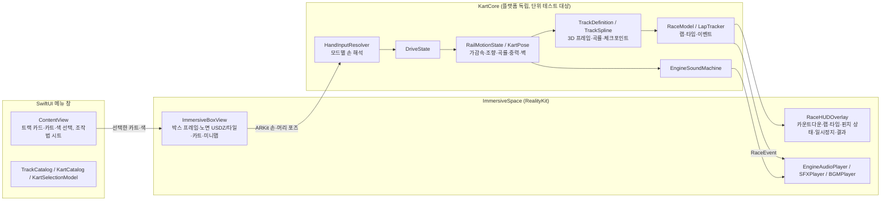

**매 프레임 입력 파이프라인** (`ImmersiveBoxView.tickMotion`)

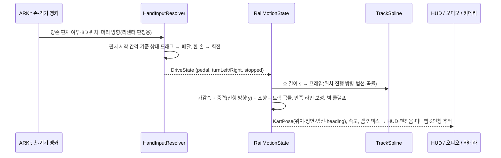

| 폴더 | 역할 |
| --- | --- |
| `KartSimulator/KartCore/` | 입력 해석, 레일 주행(`TrackSpline`·`RailMotionState`), 트랙 정의(스키마 1·2), 랩·HUD 상태·일시정지, 엔진음 상태 기계, 카트 정면 보정, 씬 배치(콕핏) |
| `KartSimulator/RealityKit/` | 박스 프레임, 타일 라이브러리, 카트 맞춤·도색·리그, 엔진음·효과음·배경음 재생, 미니맵 빌더(테마·라벨) |
| `KartSimulator/Models/` | 트랙·카트 카탈로그, 선택 상태(트랙·카트·색), 이머시브 세션 상태 |
| `KartSimulator/Resources/` | 카트 USDZ·텍스처, 타일 USDZ, 서킷 노면 USDZ + 트랙 JSON 4개, 효과음·엔진음·배경음, Galmuri 폰트, 미니맵 받침 |
| `KartCoreTests/` | Swift Testing 87개 (입력 해석·조향·정면 보정·씬 배치·추적 카메라·미니맵 투영·카트 리그·트랙 경로·랩·스플라인·레일 주행·서킷 통합) |
| `Tracks/`, `Tools/` | 서킷 JSON 3개(`gen_circuit.py`) + 격자 트랙 JSON·생성·검증 스크립트, 노면 메시 빌더 `build_circuit.py`(Blender → USDZ), glb→USDZ 변환 |

## 디자인 산출물 (디자인)

디자인은 Blockbench와 Node 생성 스크립트로 산출물을 만들어 `design` 브랜치에 올립니다. 그림 대부분은 손으로 그리지 않고 **픽셀 마스크 → SVG** 스크립트(`Design/tools/*.mjs`)로 만들어, 색이나 치수를 바꾸면 다시 생성합니다.

| | |
| --- | --- |
| 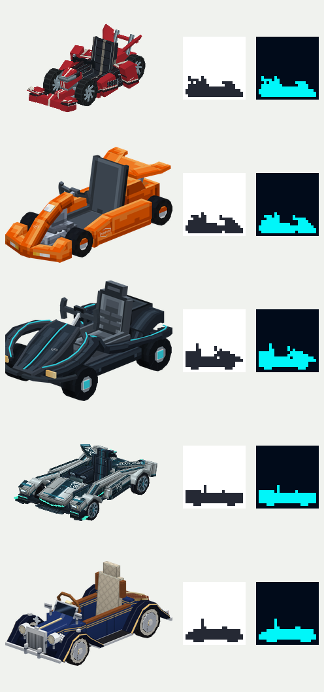 | 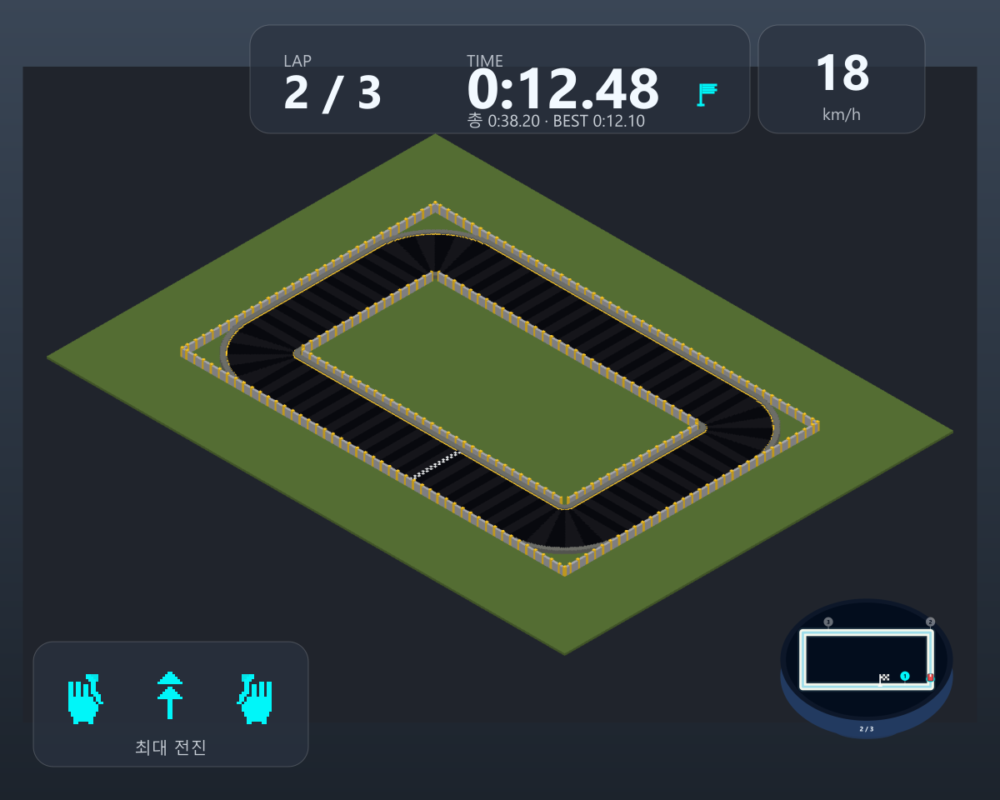 |
| 카트 5종 썸네일(메뉴 카드)과 24 px 실루엣(HUD·미니맵용) | 주행 화면 목업: 랩·타임 패널, 핀치 상태 + 페달 게이지, 미니맵 |

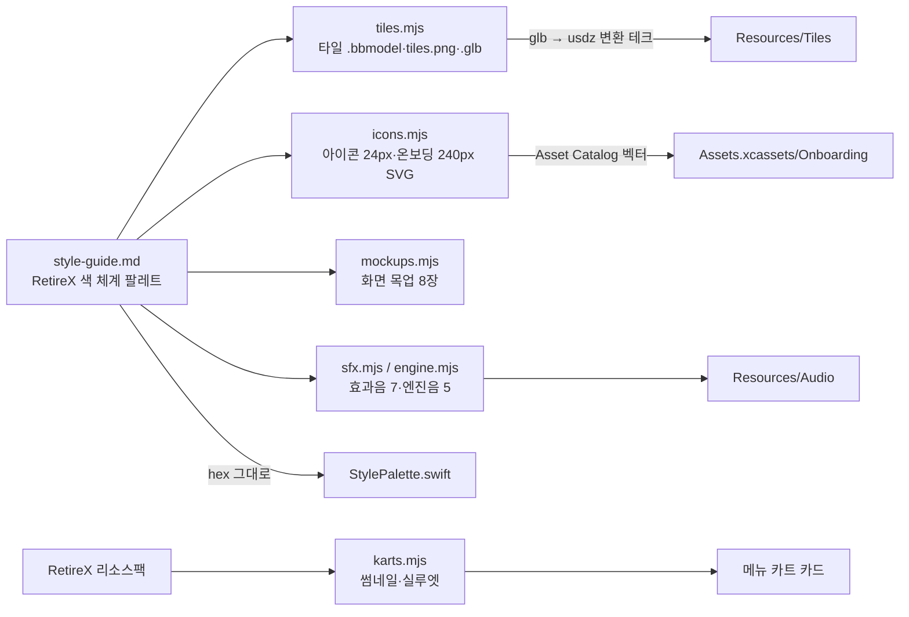

| 산출물 | 위치 | 비고 |
| --- | --- | --- |
| 스타일 가이드·팔레트 | `Design/style-guide.md`, `Design/palette.png` | 트랙 7색·UI 11색·카트 도색 17색·미니맵 3색 |
| 트랙 타일 4종 | `Assets/blockbench/tiles/`, `Assets/export/glb/` | 어느 회전으로 붙여도 이음새가 맞는 4 m 정사각 타일 |
| 아이콘 세트 | `Design/icons/icon_*.svg` | 24×24, 2 px, `currentColor` |
| 온보딩 그림 5장 | `Design/onboarding/gesture_*.svg` | 두 모드 공용(디자인 결정 55-3), 240×240 |
| 화면 목업 8장 | `Design/mockups/` | 시작·조작법·대기·카운트다운·주행·일시정지·결과·미니맵 |
| 효과음·엔진음 | `Assets/sfx/` | 출처·라이선스는 `Assets/sfx/LICENSES.md` |
| 배경음 3곡 | `Assets/bgm/` | iMasterProX 원곡(공동 저작물), 재생 규칙은 `Assets/bgm/README.md` |
| 폰트 | `Design/fonts/` | Galmuri (SIL OFL 1.1) |

## 테크 × 디자인 협업 흐름

한 저장소에서 테크는 `Dev`, 디자인은 `design` 브랜치만 쓰고, 둘 다 `main`으로 PR을 보냅니다. 서로의 요청·답변은 코드가 아니라 **`Docs/decisions.md`의 번호 붙은 결정 기록**으로 주고받습니다(2026-10-12 기준 58번까지).

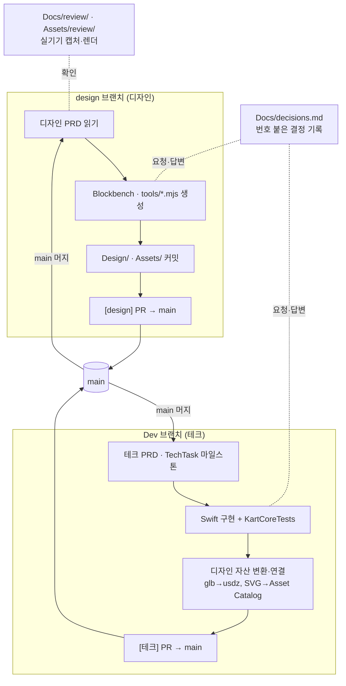

**실제로 돌아간 예 (운전 모드 3종)**

| 순서 | 누가 | 무엇을 | 기록 |
| --- | --- | --- | --- |
| 1 | 테크 | 운전 모드 3종 Phase 1 구현, 1인칭·3인칭 조작법은 SF Symbols로 자리만 | 결정 39, PR #15 |
| 2 | 디자인 | 디오라마 캡션 개정 + 1인칭 2장·3인칭 4장 그림 신규, 테크가 제안한 파일명 그대로 | 결정 40, PR #16 |
| 3 | 테크 | 그림 6장을 Asset Catalog에 넣고 `OnboardingView` 자리표시자 교체 | 결정 41, PR #15 |

규칙 요약 — 파일명·그룹명·`RaceEvent` 이름은 PRD 표를 따르고 바꾸지 않는다(바꾸려면 Issue로 먼저 합의). 팔레트에 없는 색은 `style-guide.md`에 먼저 추가한다. 디자이너 소유 폴더(`Design/`, `Assets/`, `Docs/design-prd.md`)에서 충돌이 나면 테크가 같은 파일을 건드린 것이다.

## 마일스톤

| 마일스톤 | 내용 | 상태 |
| --- | --- | --- |
| M0 | 프로젝트 셋업, visionOS 빌드, 카트 USDZ, `KartCoreTests` | ✅ |
| M1 | 박스 이머시브 공간 + 카트 쇼케이스(카드 호버 라이브 3D, 도색) | ✅ (Digital Crown 실기기 확인 1건 남음) |
| M2 | 핀치 입력 프로토타입 → 연속 페달 → 운전 모드(디오라마·3인칭, 1인칭은 폐기) | ✅ |
| Phase 2 | 3인칭 콕핏: 실제 크기 트랙 + 카트 진행 방향 기준 추적 카메라 (`ScenePlacement`, `ChaseCameraReference`) | ✅ 결정 44~47·49 (1인칭은 폐기) |
| M3 | 트랙 타일 3D 배치, 주행 로직, 벽 콜리전, 트랙 생성·검증 스크립트 | ✅ |
| M4 | 미니맵(Diorama 테이블, 궤적, 마커, 테마 색·구간 라벨) | ✅ 결정 48·53·58 |
| M5 | HUD·효과음·엔진음·팔레트·폰트·조작법 화면 · 카운트다운 잠금·결과 화면·다시 하기·배경음(결정 56) · 트랙 선택·일시정지(결정 57) | ✅ (속도계 #28은 디자인 리소스 도착 후) |
| 서킷 3종 | 3D 스플라인 트랙 생성기, Blender 노면 USDZ, 레일 주행 모델, 루프 카메라, 테마 미니맵 — 루키 오벌·리본 루프·스카이 스파이럴 | ✅ 결정 58, 실기기 튜닝 피드백 반영 예정 |
| M6 | 성능 측정·컬링(#45), 디버그 코드 제거·아카이브·접근성·아이콘(#46) | ⬜ |
| iOS/iPadOS | 아이폰·아이패드 버전 — KartCore 공유, 터치 조작, 탑뷰/3인칭 카메라, (선택) AR (#47~#51, 결정 56) | ⬜ M6 뒤 |

상세 체크리스트는 `Docs/TechTask.md`, 디자인 납품 체크리스트는 `Docs/design-prd.md` 15장. 남은 작업은 GitHub [이슈](https://github.com/kimminung/KartSimulator/issues)·[마일스톤](https://github.com/kimminung/KartSimulator/milestones)으로 관리합니다.

## 저장소 구조

```text
KartSimulator/
├─ KartSimulator/            앱 타깃 (SwiftUI · RealityKit)
│  ├─ KartCore/              플랫폼 독립 로직 (입력·주행·트랙·랩·엔진음 상태)
│  ├─ RealityKit/            박스·타일·카트·오디오
│  ├─ Models/, Utilities/    카탈로그·세션 상태, 팔레트·확장
│  ├─ Resources/             카트·타일·서킷 USDZ, 트랙 JSON, 오디오, 폰트
│  └─ Assets.xcassets/       온보딩 벡터 이미지 등
├─ KartCoreTests/            Swift Testing
├─ Tracks/, Tools/           서킷·트랙 JSON + 생성·검증 스크립트, Blender 노면 빌더·변환
├─ Design/                   스타일 가이드, 아이콘, 온보딩, 목업, 폰트, 생성 도구
├─ Assets/                   Blockbench 원본, glb 내보내기, 효과음, 리뷰 캡처
└─ Docs/                     tech-prd · design-prd · TechTask · decisions · review
```

| 문서 | 내용 |
| --- | --- |
| [`Docs/tech-prd.md`](Docs/tech-prd.md) | 테크 요구사항 |
| [`Docs/design-prd.md`](Docs/design-prd.md) | 디자인 요구사항(팔레트·카트·타일·HUD·온보딩·전달 규칙·브랜치 운영) |
| [`Docs/TechTask.md`](Docs/TechTask.md) | 마일스톤별 체크리스트 |
| [`Docs/decisions.md`](Docs/decisions.md) | 번호 붙은 결정 기록 (테크·디자인 공용) |
| [`Design/HANDOFF_RETIREX.md`](Design/HANDOFF_RETIREX.md) | 디자인 산출물 인계·재생성 방법 |

## 팀

| 역할 | 담당 | 브랜치 | 소유 폴더 |
| --- | --- | --- | --- |
| Tech | [@kimminung](https://github.com/kimminung) | `Dev` | `KartSimulator/`, `KartCoreTests/`, `Tracks/`, `Tools/`, `Docs/tech-prd.md`, `Docs/TechTask.md` |
| Design | [@iMasterProX](https://github.com/iMasterProX) | `design` | `Design/`, `Assets/`, `Docs/design-prd.md` |

<details>
<summary>작업 기록 — 2026-10-10 디자인 피드백 왕복 (접힘)</summary>

**카트 선택 메뉴 1차 구현 화면 (디자이너 확인 요청)** — Vision Pro에서 캡처한 초기 메뉴 화면입니다. 당시에는 팔레트·픽셀 폰트·아이콘 스타일 가이드가 반영되지 않은 기본 SwiftUI 스타일이었습니다.

- 카트 아이콘: 6종 모두 동일한 SF Symbols 차 아이콘(임시) → 실제 썸네일/실루엣으로 교체 필요
- 색상 스와치: 17개 원이 라벨 없이 촘촘 → 크기·간격·이름 표시 의견 요청
- 타이포: 제목에만 픽셀 폰트(Galmuri)를 쓰는 방향 확인 요청
- 카드/버튼: 기본 글래스 재질·선택 테두리 방향 의견 요청

| | |
| --- | --- |
|  |  |

**디자인 피드백 반영 결과 (`Docs/decisions.md` 20·21번)**

- 카트 아이콘 → 메뉴 카드에 실제 USDZ를 띄우고 드래그로 360° 회전(이후 결정 36·37로 "호버 시에만 라이브 3D"로 조정)
- 색상 스와치 → 원 28→40 pt, 간격 10→14 pt, 색상환 순 정렬
- 타이포 → 제목에만 Galmuri 적용(결정 35)
- 카드/버튼 → 글래스 재질 유지
- 카트 로스터 → 5종 확정, `mms` 제외(일반 자동차 모델, 29 MB 리소스 삭제)
- 박스 치수 → 실기기 테스트로 0.7 × 0.4 × 0.7 m 확정

</details>

## 라이선스

**이 저장소는 오픈소스가 아닙니다.** 소스 코드와 디자인 산출물(카트·트랙·아이콘·그림·효과음·팔레트 등, RetireX Online에서 가져온 카트 자산 포함 — Issue #34)의 저작권은 [@kimminung](https://github.com/kimminung)과 [@iMasterProX](https://github.com/iMasterProX) 두 사람이 공동으로 가지며, 상업적 이용·재배포·파생 저작물 제작·에셋 단독 이용은 두 저작권자 모두의 사전 서면 허락 없이는 금지됩니다. 전문은 [`LICENSE`](LICENSE)에 있습니다.

다음은 이 라이선스가 아니라 각자의 원래 조건을 따릅니다.

| 구성 요소 | 조건 |
| --- | --- |
| Galmuri 폰트 (`Design/fonts/`, 앱 번들 `Resources/Fonts/`) | © 2019–2025 Lee Minseo (quiple), SIL Open Font License 1.1 (`OFL.txt` 동봉, 앱 메뉴 하단 크레딧) |
| 엔진음 5개 (`engine*.wav`) | CYBOX "XK ENGINE 3.0.0" 원본(CC0 기반) 변환, 출처 사슬은 `Assets/sfx/LICENSES.md` |
| RetireX Online 참고 자료 (`Design/reference/retirex/`) | 참고용. 마인크래프트 요소는 Mojang/Microsoft 소유, 앱·홍보에 쓰지 않음 |
| Apple SDK·시스템 폰트 | Apple 개발자 라이선스 (저장소에 미포함) |
| 미니맵 받침 `Diorama_Base.usdz` (`KartSimulator/Resources/Minimap/`) | Apple Diorama 샘플 코드 라이선스 (전문은 같은 폴더 `LICENSE-Apple-Diorama-Sample.txt`) |
