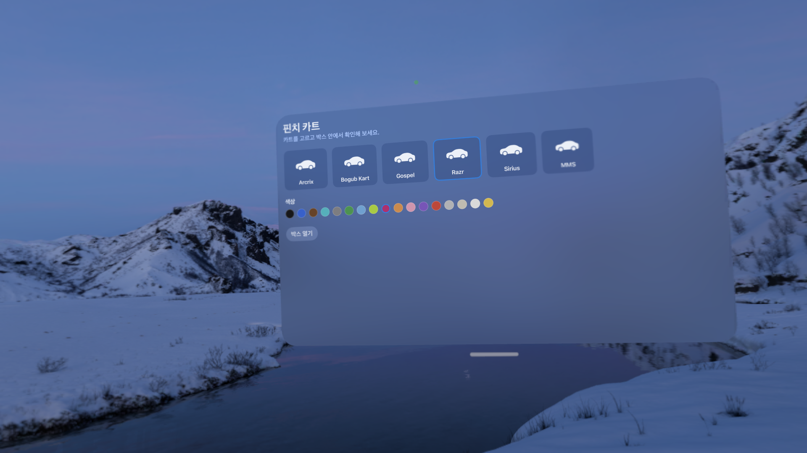
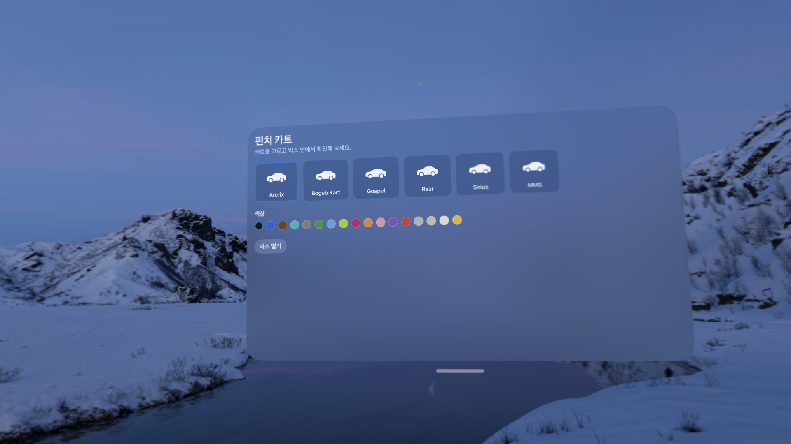

# KartSimulator

카트 레이싱 시뮬레이터 프로젝트입니다. 현재 개발이 막 시작된 초기 단계입니다. 🏁

## 현재 상태

- [x] 프로젝트 초기 세팅 (SwiftUI 기반 Xcode 프로젝트)
- [ ] 핵심 게임플레이 구현
- [ ] UI/UX 디자인 적용
- [ ] 테스트 및 QA

## 디자인 피드백

PR·날짜별로 아래 접은 항목을 하나씩 추가해 캡처와 피드백 요청 사항을 남깁니다. 디자이너는 각 항목을 펼쳐 이미지와 요청 사항을 확인해 주세요.

2026-10-10 — 카트 선택 메뉴 1차 구현 화면 (디자이너 확인 요청)

Vision Pro에서 캡처한 현재 메뉴 화면입니다. 아직 `Docs/design-prd.md`의 팔레트·픽셀 폰트·아이콘 스타일 가이드는 반영되지 않은 기본 SwiftUI 스타일입니다. 아래 항목에 대해 디자이너 피드백을 부탁드립니다.

- **카트 아이콘**: 6종(`Arcrix`, `Bogub Kart`, `Gospel`, `Razr`, `Sirius`, `MMS`) 모두 동일한 SF Symbols 차 아이콘(임시)을 쓰고 있습니다. 실제 카트별 썸네일/실루엣으로 교체가 필요한데, 디자인 PRD 3장 아이콘 규격(24×24, 2px 선)에 맞춰 작업 가능한지 확인 부탁드립니다.
- **색상 스와치**: 17개 색상 원이 라벨 없이 촘촘하게 붙어 있습니다. 크기·간격을 키울지, 선택 시 색상 이름을 보여줄지 의견 부탁드립니다.
- **타이틀/본문 타이포**: "핀치 카트" 제목과 본문이 시스템 폰트로 표시됩니다. 디자인 PRD의 픽셀 폰트(Galmuri)를 제목에만 적용하는 방향이 맞는지 확인 부탁드립니다.
- **카드/버튼 스타일**: 카트 카드와 "박스 열기" 버튼이 기본 `.regularMaterial`/기본 버튼 스타일입니다. 모서리 반경, 글래스 재질, 선택 상태 표시(현재는 파란 테두리만) 방향에 대한 의견 부탁드립니다.

| | |
| --- | --- |
|  |  |

## 기술 스택

| 영역 | 내용 |
| --- | --- |
| 언어 | Swift |
| UI 프레임워크 | SwiftUI |
| IDE | Xcode |

## 팀 구성

| 역할 | 담당 |
| --- | --- |
| Tech | @coulson (본인) |
| Design | 협업 예정 (초대 예정) |

> 디자이너 협업자가 합류하면 이 표를 업데이트할 예정입니다.

## 시작하기

1. 저장소를 클론합니다.
2. `KartSimulator.xcodeproj` (또는 `.xcworkspace`)를 Xcode에서 엽니다.
3. 시뮬레이터 또는 실기기를 선택해 빌드 및 실행합니다.

## 브랜치 / 협업 규칙

- 작업은 기능 단위로 브랜치를 분리해 진행합니다. (예: `feature/track-selection`)
- 변경 사항은 Pull Request를 통해 공유 및 리뷰합니다.
- 커밋 메시지는 변경 목적을 간단히 설명합니다.

## 라이선스

추후 결정 예정
